# Store Sales Forecasting for Corporacion Favorita

A 16 day forecast of items sold for every store and product family, using an ensemble of three boosted tree models and a comparison with SARIMAX.

## At a glance

* **The problem:** plan daily item demand across 54 stores and 33 product families.
* **The result:** the ensemble forecasts 12,869,361 units for the next 16 days.
* **The main insight:** chain daily error is 3.87 percent, while store and family error is 11.61 percent.

This is an educational project.

[](https://www.python.org/)
[](https://scikit-learn.org/)
[](https://lightgbm.readthedocs.io/)
[](https://www.statsmodels.org/)
[](https://pandas.pydata.org/)

Kaggle notebook link coming soon

Power BI dashboard coming soon

## Forecast at chain level

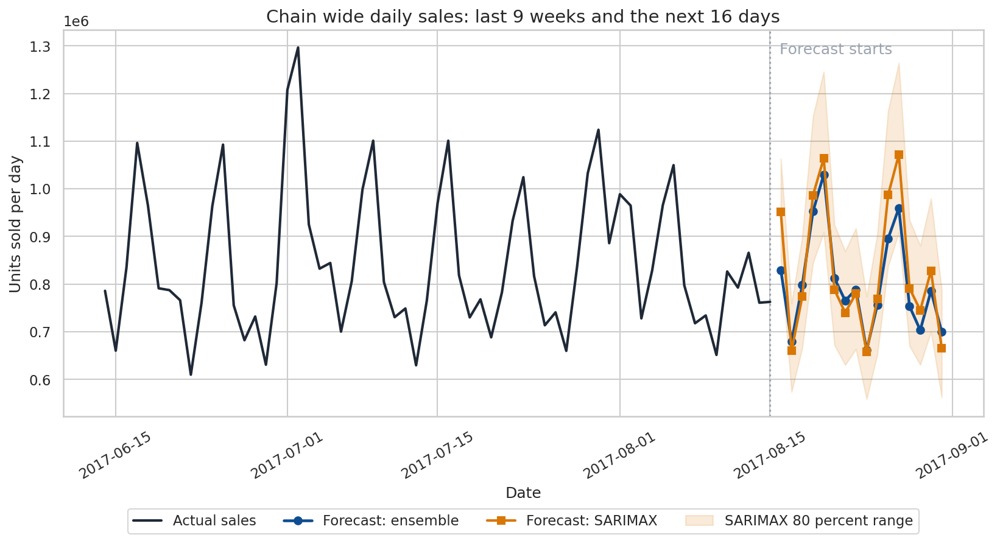

> * **What it shows:** Actual and forecast units at chain level.
> * **Why it matters:** It shows the daily volume pattern for buying and workforce planning.
> * **What to do with it:** Prepare for the Sunday peak and the quieter Thursday.

## The business problem

Corporacion Favorita needs a daily item forecast for ordering and staffing. The forecast supports a store owner, regional manager, buyer and workforce planner. It predicts items sold, not money. Prices are not in the data, so this project makes no claim about revenue, savings, waste or profit.

The headline forecast is 12,869,361 units over the next 16 days. This is 3.4 percent below the previous 16 days. The busiest forecast day is Sunday 20 August with 1,029,991 units. The quietest is Thursday 24 August with 661,170 units.

## How it works

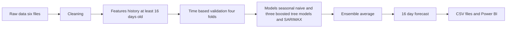

The 16 day rule makes the validation realistic. To forecast 1 August, the model can use sales from 16 July or earlier, but not sales from 17 July through 31 July. The same rule is applied to every day in the forecast window. The shortest sales lag is 16 days, and context variables are also delayed by 16 days.

The four validation folds are shown below. The metrics in this README are averages across the four folds.

| Fold | Training ends | Validation starts | Validation ends |
|---|---|---|---|
| Fold 1 | 2017 07 30 | 2017 07 31 | 2017 08 15 |
| Fold 2 | 2017 07 14 | 2017 07 15 | 2017 07 30 |
| Fold 3 | 2017 06 28 | 2017 06 29 | 2017 07 14 |
| Fold 4 | 2017 06 12 | 2017 06 13 | 2017 06 28 |

## The data

The six source files cover 2013 01 01 through 2017 08 15 for the training records. The test records cover 2017 08 16 through 2017 08 31. There are 54 stores, 33 product families and 1,782 store and family series.

| File | What it holds | Date range |
|---|---|---|
| `train.csv` | Historical daily units, store, family and planned promotion values | 2013 01 01 to 2017 08 15 |
| `test.csv` | Future store and family keys with planned promotion values | 2017 08 16 to 2017 08 31 |
| `stores.csv` | Store city, state, type and cluster | No date column |
| `oil.csv` | Daily oil price context | 2013 01 01 to 2017 08 31 |
| `holidays_events.csv` | Holiday and event calendar with location and transfer fields | 2012 03 02 to 2017 12 26 |
| `transactions.csv` | Store transaction counts by day | 2013 01 01 to 2017 08 15 |

Data quality checks found 43 missing oil prices. Forward fill and backward fill removed all oil price gaps. Four Christmas dates were missing from the training calendar because stores were closed. Fifty three stores started selling after the data began. Twelve transferred holiday rows were removed, and 4,816 store days were flagged as holidays.

Duplicate row counts printed by the notebook were zero for every source table. This includes `train.csv`, `test.csv`, `stores.csv`, `oil.csv`, `holidays_events.csv` and `transactions.csv`.

## What the data shows

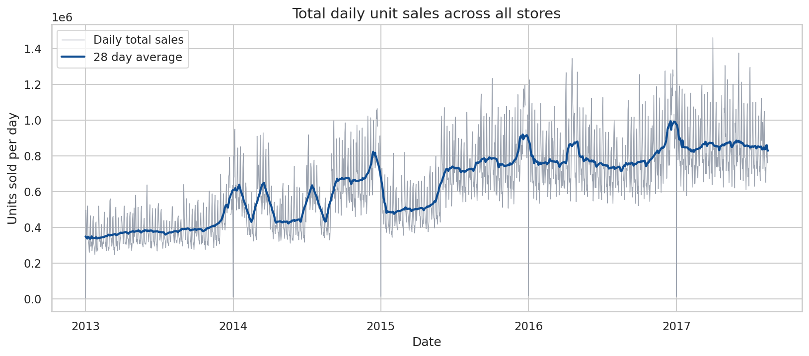

> * **What it shows:** Chain sales grew from an average of 385,766 units per day in 2013 to 855,582 units per day in the incomplete 2017 view.
> * **Why it matters:** Buyers need to account for a rising demand level.
> * **What to do with it:** Use recent history when setting order quantities.

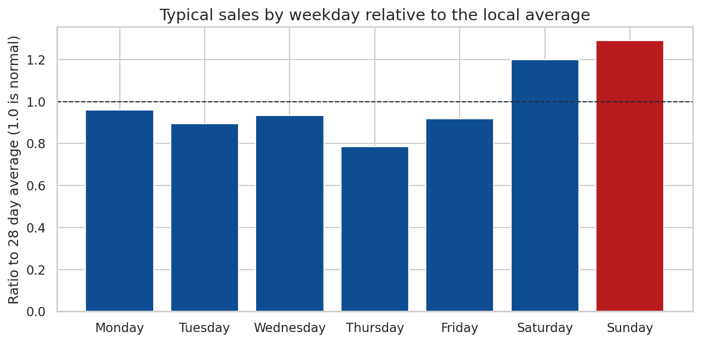

> * **What it shows:** Sunday has the highest relative level at 1.291, while Thursday is lowest at 0.786.
> * **Why it matters:** Weekly rhythm affects store labor and replenishment.
> * **What to do with it:** Schedule more staff and stock for the strongest weekdays.

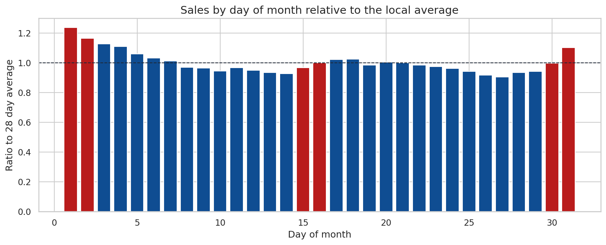

> * **What it shows:** The five strongest calendar days include day 1 at 1.238 and day 2 at 1.165.
> * **Why it matters:** Payday timing can shift item demand.
> * **What to do with it:** Check early month orders and promotion timing.

<details>
<summary>More exploration charts</summary>

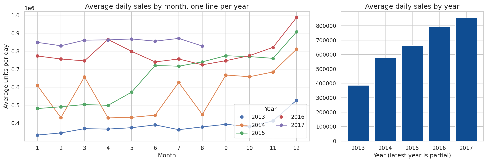

> * **What it shows:** Monthly patterns and long term growth across years.
> * **Why it matters:** Seasonal demand changes the baseline for buying.
> * **What to do with it:** Compare the forecast with the current seasonal shape.

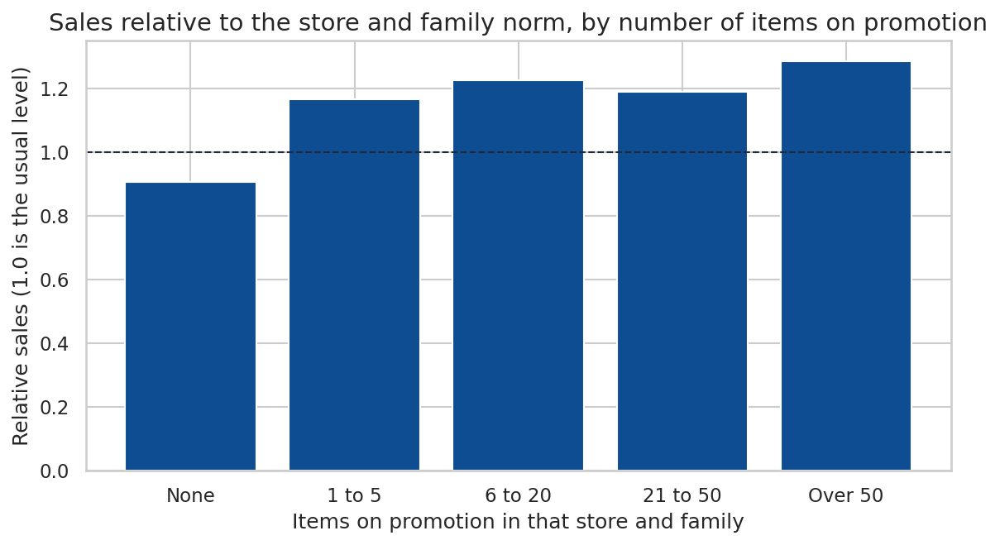

> * **What it shows:** Relative sales rise from 0.905 with no promotion to 1.286 for more than 50 promoted items.
> * **Why it matters:** Promotion plans are a known input.
> * **What to do with it:** Review promotion volume before finalizing orders.

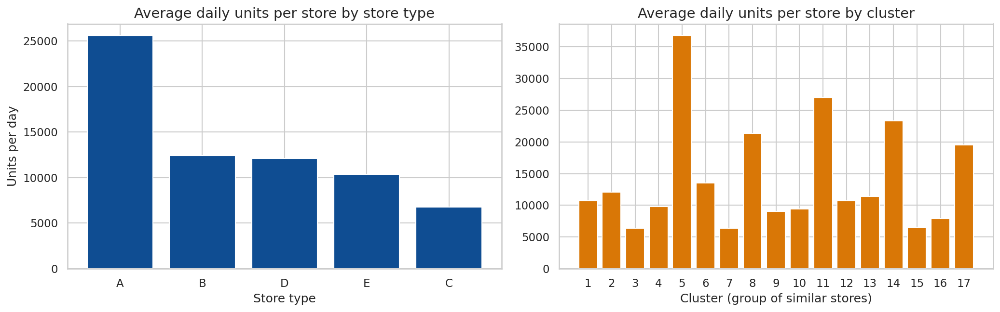

> * **What it shows:** Store groups have different sales levels.
> * **Why it matters:** A single chain average does not fit every location.
> * **What to do with it:** Use store level forecasts for local decisions.

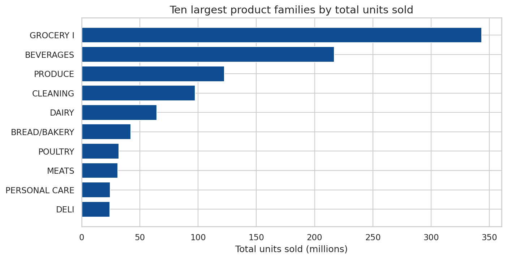

> * **What it shows:** The top three families provide 63.6 percent of historical units in total.
> * **Why it matters:** Errors in large families affect total volume most.
> * **What to do with it:** Give these families priority in buying reviews.

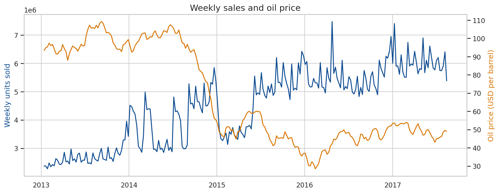

> * **What it shows:** Level correlation with oil is negative 0.771, while weekly change correlation is 0.022.
> * **Why it matters:** Trend can make levels look related when short term movement is not.
> * **What to do with it:** Treat oil as supporting context rather than a main demand signal.

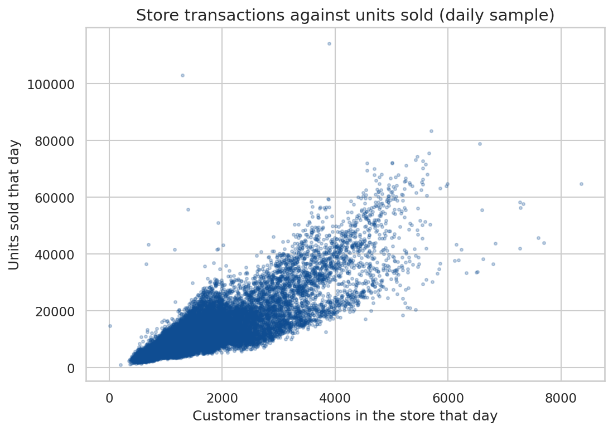

> * **What it shows:** Transactions and sales have correlation 0.837.
> * **Why it matters:** Recent traffic helps describe store demand.
> * **What to do with it:** Use delayed transaction context, since future transactions are unknown.

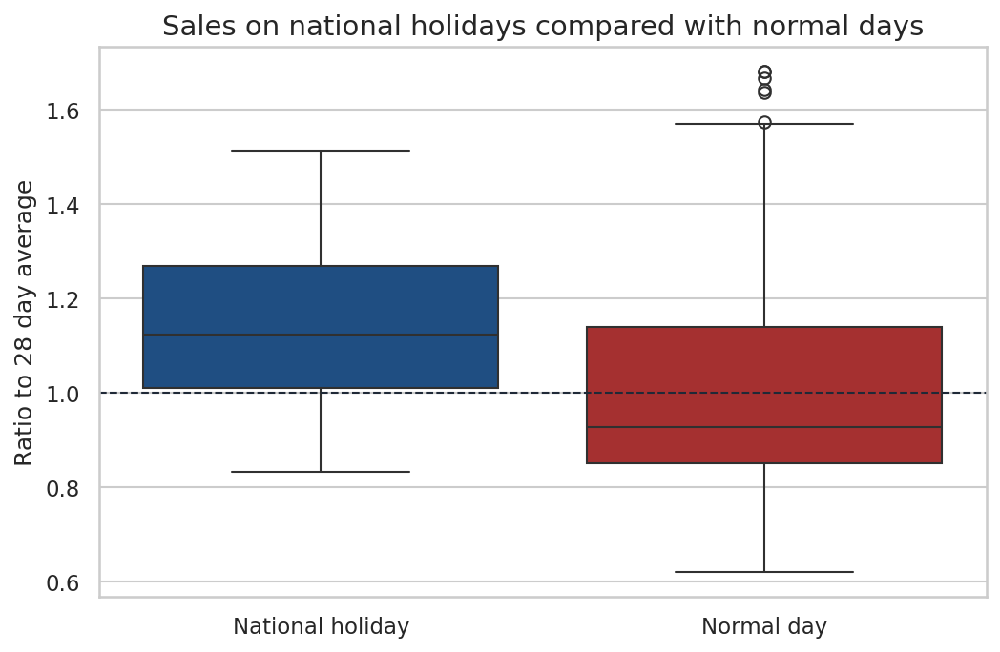

> * **What it shows:** National holiday mean ratio is 1.142 versus 0.994 on normal days.
> * **Why it matters:** Holidays can shift store demand.
> * **What to do with it:** Review holiday stock and staffing plans.

</details>

## The models

| Model | Role |
|---|---|
| Seasonal naive | A same weekday baseline with no training |
| Gradient boosting | Uses a log target so large families do not dominate |
| LightGBM Tweedie | Uses raw units and a loss suited to non negative counts with many zeros |
| Recent gradient boosting | Uses the most recent two years to adapt to current levels |
| Ensemble average | Equal average of the three boosted tree forecasts |
| SARIMAX | An explainable comparison for chain total and one store |

The three boosted tree models share the same features but learn different target views and history windows. Equal weights are used because four folds are too small for reliable learned weights. The ensemble is a practical compromise that is easy to explain and avoids fitting weights to noise.

SARIMAX models one series at a time. It is useful for interpretation, a confidence range and a sanity check. It is not the production forecast for every store and family.

## Results

The tables below are built from `outputs/powerbi_model_comparison.csv`. Each value is the average across four validation folds. WAPE is total absolute error divided by total actual units. Lower is better.

### Store and family level

| Model | MAE units | WAPE | RMSLE |
|---|---:|---:|---:|
| Seasonal naive | 79.9762 | 16.96 percent | 0.5448 |
| Gradient boosting | 58.1347 | 12.30 percent | 0.3976 |
| LightGBM Tweedie | 55.1298 | 11.67 percent | 0.4147 |
| Gradient boosting recent | 57.2210 | 12.11 percent | 0.4024 |
| Ensemble average | 54.8253 | 11.61 percent | 0.3974 |

### Chain total level

| Model | MAE units | WAPE |
|---|---:|---:|
| Seasonal naive | 67,293.6455 | 8.02 percent |
| Gradient boosting | 33,276.4074 | 3.95 percent |
| Ensemble average | 32,624.5205 | 3.87 percent |
| SARIMAX | 58,859.8159 | 7.03 percent |
| Ensemble plus SARIMAX | 36,858.8965 | 4.40 percent |

### Single store level

| Model | Store | MAE units | WAPE |
|---|---|---:|---:|
| Seasonal naive | Store 44 | 4,171.2815 | 9.58 percent |
| Gradient boosting | Store 44 | 3,611.7674 | 8.12 percent |
| Ensemble average | Store 44 | 3,144.5945 | 7.10 percent |
| SARIMAX | Store 44 | 3,470.2294 | 7.98 percent |
| Ensemble plus SARIMAX | Store 44 | 3,058.0022 | 6.98 percent |

Only four validation folds of 16 days were used, so small differences are within noise. The ensemble was strongest at chain level and had the lowest average store and family WAPE. SARIMAX was worse at chain level, while the blend was marginally best for Store 44. That small single store difference is not strong enough to change the production choice.

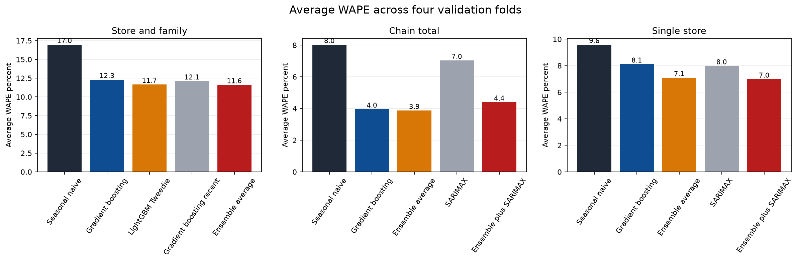

> * **What it shows:** Average WAPE for the models at store and family, chain total and single store levels.
> * **Why it matters:** Error depends on the decision level.
> * **What to do with it:** Use store and family WAPE for shelf orders and chain WAPE for total buying volume.

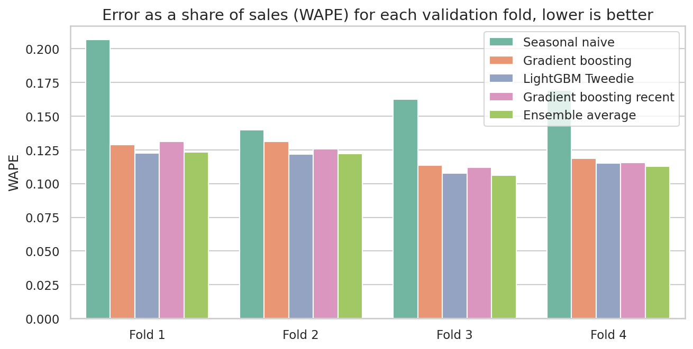

> * **What it shows:** WAPE for each of the four 16 day validation folds.
> * **Why it matters:** A stable model should not depend on one lucky period.
> * **What to do with it:** Treat small differences as ties when choosing an operating model.

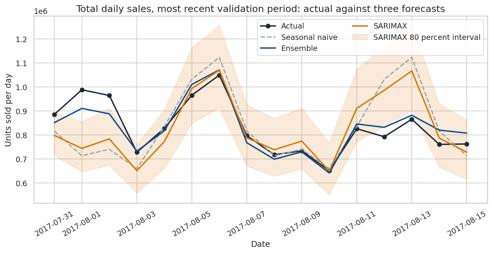

> * **What it shows:** Actual chain units compared with tree and SARIMAX forecasts.
> * **Why it matters:** Chain totals guide buying volume and cash planning.
> * **What to do with it:** Use the ensemble total and investigate large differences from SARIMAX.

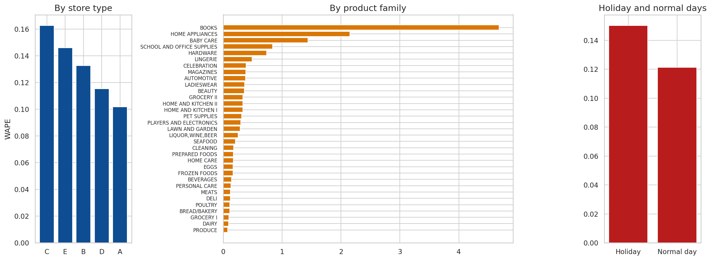

> * **What it shows:** Error by store type, family and holiday status on the most recent fold.
> * **Why it matters:** Weakness is concentrated in sparse families such as Books, with 4.685 WAPE and nearly zero share of sales.
> * **What to do with it:** Use a larger ordering buffer for sparse families and focus review on high volume families.

The weakest area is the sparse tail of product families. Books had WAPE 4.685, Home Appliances 2.149 and Baby Care 1.439, but these families held close to zero percent of total sales. Their errors matter for local shelves and inflate proportion based metrics more than chain volume.

<table>
<tr>
<td>
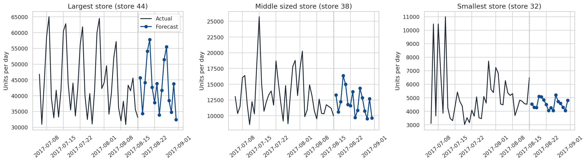

> * **What it shows:** Forecast paths for selected stores.
> * **Why it matters:** Locations have different volume patterns.
> * **What to do with it:** Plan local staffing and replenishment from the store view.
</td>
<td>
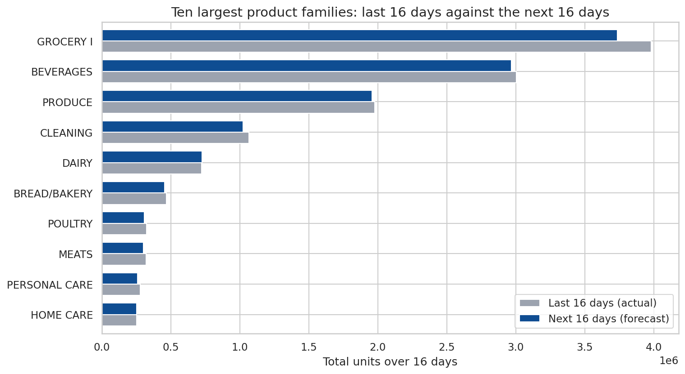

> * **What it shows:** Forecast paths for selected product families.
> * **Why it matters:** Category demand is not uniform.
> * **What to do with it:** Use family forecasts to set shelf orders and promotion checks.
</td>
</tr>
</table>

<details>
<summary>Feature and store diagnostics</summary>

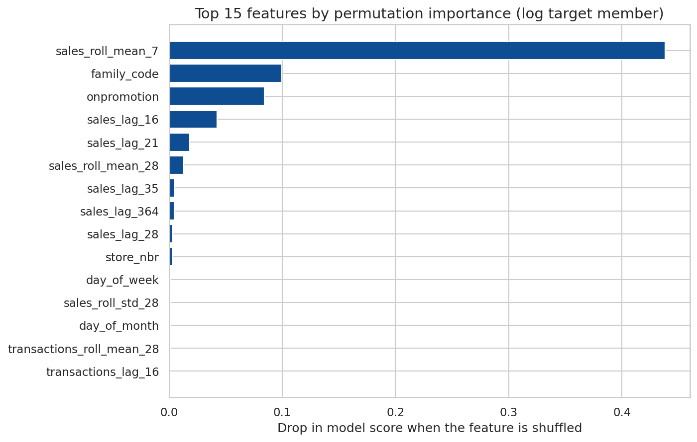

> * **What it shows:** Recent rolling sales history is the strongest feature, followed by family code and promotion count.
> * **Why it matters:** The forecast responds mainly to recent demand and known plans.
> * **What to do with it:** Keep recent history and promotion inputs reliable.

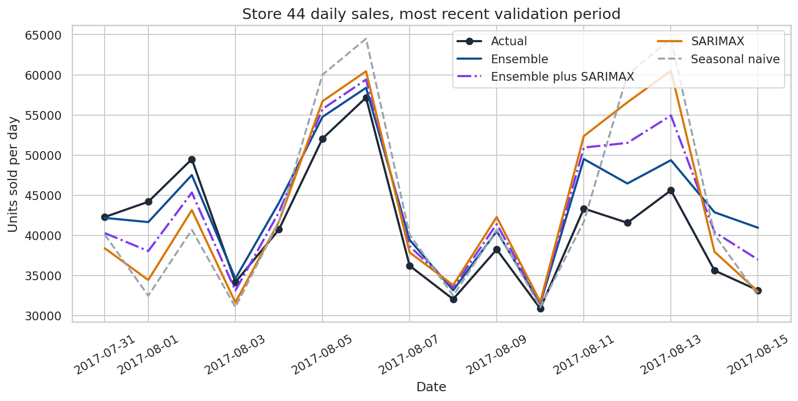

> * **What it shows:** Store level forecasts compared with actual units.
> * **Why it matters:** Local demand is noisier than the chain total.
> * **What to do with it:** Add a practical safety margin to store and family orders.

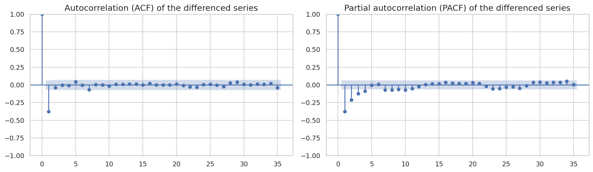

> * **What it shows:** Autocorrelation patterns used to select SARIMAX orders.
> * **Why it matters:** Weekly structure supports a seasonal comparison model.
> * **What to do with it:** Use this diagnostic when checking the chain sanity forecast.

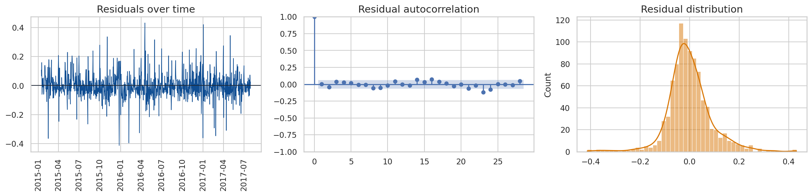

> * **What it shows:** Residual checks for the chain SARIMAX fit, including a Ljung Box p value of 0.2502.
> * **Why it matters:** There is no strong evidence of leftover structure in this check.
> * **What to do with it:** Keep SARIMAX as an explanatory comparison, not the main forecast.

</details>

## Using the forecast

The unit is items sold. For a single shelf or product family, use the 11.61 percent store and family WAPE as a planning guide. For chain daily volume, use the 3.87 percent chain WAPE. The chain error is about three times smaller because over and under forecasts across many series partly cancel.

* **Ordering:** Use the store and family forecast as the base quantity. Add a safety margin that reflects the larger local error, especially for sparse families.
* **Staffing:** Use daily store and chain totals to place more cashiers and shelf staff on high volume days.
* **Promotions:** Promotions are known inputs. Compare planned promotion counts with expected units before confirming a category plan.
* **Cash flow:** Use total item volume as an early operating signal. Prices are not available, so this is not a money forecast.

### Output files

| File | Use |
|---|---|
| `outputs/forecast_by_store_and_family.csv` | Final 16 day units for each store and product family |
| `outputs/powerbi_sales_forecast.csv` | Actual and forecast records for Power BI |
| `outputs/powerbi_accuracy_by_group.csv` | Accuracy by product family, store type and holiday group |
| `outputs/powerbi_model_comparison.csv` | Fold results for model comparison |
| `outputs/submission.csv` | Competition format forecast with id and sales |
| `outputs/ensemble_models.joblib` | Saved ensemble model objects |

### Power BI column dictionary

`powerbi_sales_forecast.csv` has these real headers:

| Column | Meaning |
|---|---|
| `date` | Calendar date |
| `record_type` | Actual or Forecast |
| `store_nbr` | Store identifier |
| `city` | Store city |
| `state` | Store state |
| `store_type` | Store type |
| `cluster` | Store cluster |
| `family` | Product family |
| `units` | Unit value used in the view |
| `actual_sales` | Actual units when available |
| `forecast_units` | Forecast units when available |
| `onpromotion` | Planned promotion count |
| `is_holiday` | Holiday flag |

`powerbi_accuracy_by_group.csv` has these real headers:

| Column | Meaning |
|---|---|
| `group_type` | Group category |
| `group` | Group name |
| `actual_sales` | Actual units |
| `abs_error` | Absolute unit error |
| `wape` | Weighted absolute percentage error |
| `share_of_sales` | Group share of actual units |

## Run it

```powershell
py -3.13 -m venv .venv
.\.venv\Scripts\Activate.ps1
python -m pip install -r requirements.txt
```

Place the source CSV files, including `sample_submission.csv`, in `raw_data`. Then open the notebook:

```powershell
jupyter notebook notebooks/time_series_analysis.ipynb
```

On Kaggle, the notebook detects the data path automatically.

The new comparison figure can be created with:

```powershell
python scripts/make_figures.py
```

## Tech stack

* Python 3.13.15
* pandas and NumPy
* scikit learn
* LightGBM
* statsmodels
* Matplotlib and seaborn
* Jupyter Notebook
* Power BI file outputs

## Project structure

```text
FUTURE_ML_01
|-- docs
|   `-- images
|       |-- eda_holidays.png
|       |-- eda_oil.png
|       |-- eda_payday.png
|       |-- eda_promotions.png
|       |-- eda_seasonality_trend.png
|       |-- eda_store_type_cluster.png
|       |-- eda_top_families.png
|       |-- eda_total_sales.png
|       |-- eda_transactions.png
|       |-- eda_weekday.png
|       |-- error_analysis.png
|       |-- evaluation_wape_by_fold.png
|       |-- feature_importance.png
|       |-- forecast_example_stores.png
|       |-- forecast_families.png
|       |-- forecast_total.png
|       |-- model_comparison.png
|       |-- sarimax_acf_pacf.png
|       |-- sarimax_residuals.png
|       |-- store_level_comparison.png
|       `-- total_level_comparison.png
|-- notebooks
|   `-- time_series_analysis.ipynb
|-- outputs
|   |-- ensemble_models.joblib
|   |-- forecast_by_store_and_family.csv
|   |-- powerbi_accuracy_by_group.csv
|   |-- powerbi_model_comparison.csv
|   |-- powerbi_sales_forecast.csv
|   `-- submission.csv
|-- raw_data
|   |-- holidays_events.csv
|   |-- oil.csv
|   |-- sample_submission.csv
|   |-- stores.csv
|   |-- test.csv
|   |-- train.csv
|   `-- transactions.csv
|-- requirements.txt
|-- scripts
|   |-- make_figures.py
|   `-- requirements.txt
`-- README.md
```

## Limitations and next steps

* Validation used only four folds of 16 days. Small differences between models are within noise.
* The ensemble members share features, so an unseen disruption can affect all three.
* The forecast covers 16 days. Longer horizons need separate validation.
* SARIMAX was tested on the chain total and Store 44 only.
* Zero units can mean no demand or no stock. Stock out data would improve interpretation.
* Price data would be needed for revenue or profit analysis.
* More holiday window features and careful model tuning could improve future runs.
* The forecast should be rerun as new sales arrive and its live error should be tracked.

Author: [Cyrus Ndung'u](https://github.com/Cyrusz55) | [Portfolio](https://cyrusz55.github.io)
